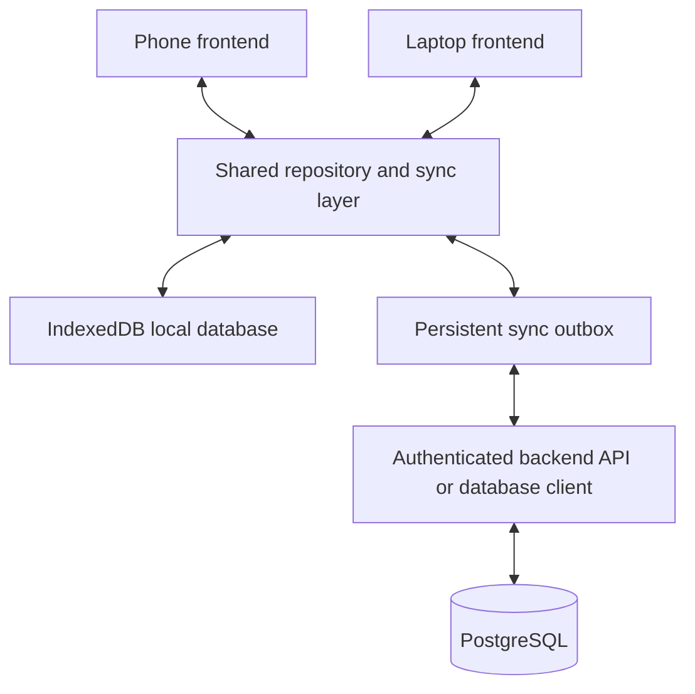
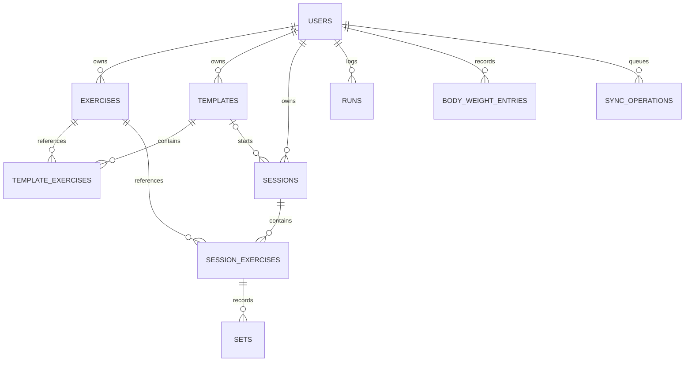
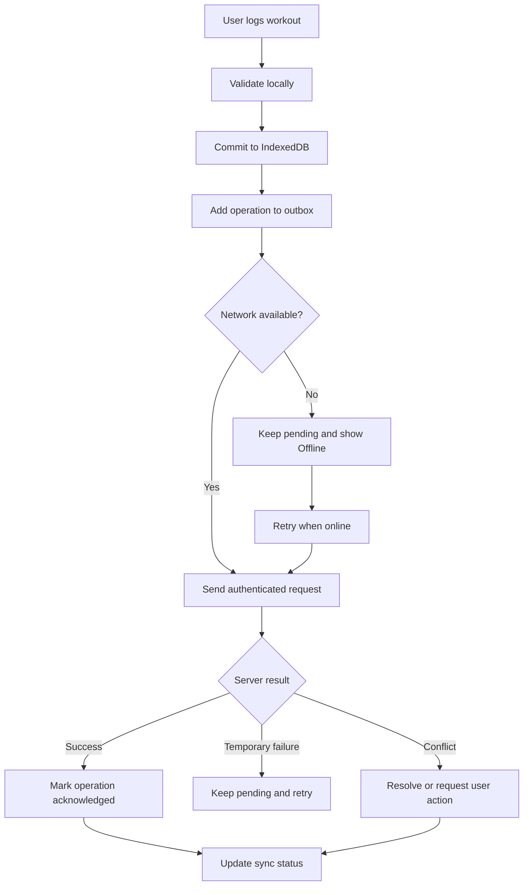

# Progression Vert — Implementation Plan

**Document type:** Product and engineering implementation specification  
**Date:** October 2026  
**Project:** Progression Vert fitness tracking application  
**Primary requirements:** Cross-device cloud sync, offline support, reusable exercises and plans, gym/running dashboard, and preservation of existing workout history.

---

## 1. Goals and scope

### P0 — Must work

- Cloud sync between phone and laptop.
- Offline-first workout logging.
- Authentication and account ownership.
- Safe migration from the existing browser-storage implementation.
- Stable exercise identity and idempotent sync operations.

### P1 — Core product

- Predefined training plans.
- Custom exercises.
- One canonical exercise reused across multiple training plans.
- Workout editing and history.
- Running and body-weight tracking.
- Weekly and monthly dashboard.

### P2 — Analytics

- Exercise-level progression.
- Muscle-group training volume.
- Running pace, distance, duration, and personal records.
- Period-over-period comparisons.

### Product principles

1. Phone-first logging; laptop-first analysis.
2. Offline actions are saved locally before attempting network requests.
3. Existing workout records are never silently discarded, merged, or rewritten.
4. Analytics are calculated from completed workout records, not plan targets.
5. Retrying imports or sync operations must not create duplicate records.

---

## 2. Recommended architecture

Keep the existing frontend and introduce the smallest backend architecture that supports secure, reliable multi-device sync.



### Technology choices

| Layer | Recommendation |
|---|---|
| Frontend | Keep the current framework and routing |
| Local persistence | IndexedDB for browser data and pending operations |
| Cloud database | PostgreSQL, preferably through Supabase if no backend exists |
| Authentication | Managed authentication with persistent sessions |
| Sync | Application-owned queue with idempotent writes |
| Charts | Reuse the existing chart library if suitable |
| Hosting | Keep the existing Vercel deployment |

Supabase is a proposed choice, not a confirmed requirement. First inspect the current codebase and dependency list. If an existing backend is already present, reuse it where practical.

### Repository boundary

All screens should read and write through a shared repository interface. Components should not access `localStorage`, IndexedDB, or the remote database directly.

Illustrative TypeScript interface:

```ts
interface FitnessRepository {
  getExercises(): Promise<Exercise[]>;
  getTemplates(): Promise<WorkoutTemplate[]>;
  getWorkout(id: string): Promise<WorkoutSession | null>;
  saveWorkout(workout: WorkoutSession): Promise<void>;
  getRuns(from: number, to: number): Promise<Run[]>;
  getDashboard(from: number, to: number): Promise<DashboardData>;
}
```

Adapt the interface and types to the existing project rather than replacing working code wholesale.

---

## 3. Data model and schema

Use one canonical record for each exercise, with separate records for its use in plans and completed workouts.



### Proposed tables

| Table | Important fields and constraints |
|---|---|
| `profiles` | `id` references auth user, display preferences, units |
| `exercises` | `id`, `user_id`, `name`, `normalized_name`, `primary_muscle`, `secondary_muscles`, `equipment`, `movement_type`, `archived_at` |
| `templates` | `id`, `user_id`, `name`, `estimated_minutes`, `sort_order`, `updated_at` |
| `template_exercises` | `id`, `template_id`, `exercise_id`, `target_sets`, `target_rep_min`, `target_rep_max`, `metric`, `sort_order` |
| `sessions` | `id`, `user_id`, `template_id` nullable, `template_name_snapshot`, `started_at`, `ended_at`, `status`, `notes`, `feeling` |
| `session_exercises` | `id`, `session_id`, `exercise_id`, `exercise_name_snapshot`, target prescription snapshot, `sort_order` |
| `sets` | `id`, `session_exercise_id`, `set_number`, `weight`, `reps`, `metric`, `is_warmup`, `completed_at` |
| `runs` | `id`, `user_id`, `started_at`, `distance_km`, `duration_seconds`, `feeling`, `run_type`, `notes` |
| `body_weight_entries` | `id`, `user_id`, `measured_at`, `weight_kg`, `notes` |
| `sync_operations` | `id`, `user_id`, `entity_type`, `entity_id`, `operation`, `payload`, `created_at`, `attempt_count`, `last_error` |

### Schema rules

- Use UUIDs as stable IDs, including for records created offline.
- Add `created_at`, `updated_at` and, where needed, `deleted_at` or tombstones.
- Add `user_id` to every user-owned top-level record. Enforce ownership in the backend, not just the frontend.
- Add foreign keys and indexes on `user_id`, `session_id`, `exercise_id` and timestamps.
- Store timestamps consistently as UTC, but group charts by the user's local calendar day and week.
- Store canonical weight in kilograms and distance in kilometres, converting for display. Preserve the existing units preference.
- Use a transaction when creating a session, its exercises and initial sets.
- Use decimal-safe weight storage or a carefully defined integer representation.

### Stable exercise identity

- `template_exercises.exercise_id` points to the canonical exercise record.
- Adding an exercise to another plan inserts a plan-assignment row, not a new exercise.
- Editing a plan's target sets or rep range changes only that plan assignment.
- Renaming an exercise changes its canonical display name but does not erase the name originally recorded in completed workouts.
- Archiving an exercise prevents new assignments while preserving historical records.

Do not use exercise names as permanent identifiers. Names are editable, and similarly named movements are not necessarily equivalent.

### Duplicate policy

1. Trim whitespace and normalize case for matching.
2. Compare the normalized name against existing exercises owned by the same user.
3. Warn when a match exists and offer to reuse it.
4. Preserve the canonical ID when merging duplicate definitions.
5. Update references in templates and workout records only through a validated, transactional merge.
6. Keep an audit record of the merge. Never automatically merge merely similar names.

For example, `Bench Press` and `bench press` are likely a naming duplicate. `Barbell Skull Crusher` and `Dumbbell Skull Crusher` are different movements and must not be merged automatically.

A unique constraint on `(user_id, normalized_name)` is appropriate if strict uniqueness is desired. If aliases are needed, map aliases to canonical exercises while keeping canonical IDs unique.

---

## 4. Migration plan — preserve every existing record

The existing export `workout-backup-2026-10-13.json` contains exercise definitions, workout templates, sessions, set logs, runs, body-weight entries, and settings. The export includes IDs and relationships that should be preserved wherever possible.

The initial export review identified approximately 32 workout sessions, 319 set logs, 18 runs, 5 body-weight entries, 34 exercise definitions, and 4 workout templates. Treat these as reconciliation targets to verify against the actual file, not as values to recreate manually.

### Safe migration sequence

1. **Back up first.** Export the original JSON, record a checksum, and keep the source unchanged.
2. **Inspect current storage.** Identify exact keys, schemas, version numbers, and import/export logic. Do not assume the export is identical to the internal storage format.
3. **Validate the export.** Count records by type, check IDs, resolve foreign keys, and detect malformed timestamps or missing relationships.
4. **Build an idempotent importer.** Preserve existing UUIDs wherever possible. Re-running the importer must not create duplicates.
5. **Upload atomically where possible.** Use transactions or staged batches; record import status and validation failures.
6. **Reconcile counts and relationships.** Compare source and destination totals, IDs, timestamps, set values, run records, and template assignments.
7. **Switch only after verification.** Retain the local source backup and provide a recovery path if migration is incomplete.

### Imperfect legacy records

Do not silently clean up historical data during migration.

| Legacy condition | Required behavior |
|---|---|
| Zero-set session | Preserve the session, even if it has no set logs |
| Unusually long duration | Preserve timestamps and flag for review; do not invent a corrected end time |
| Missing run fields | Preserve the run and use nullable fields for unavailable information |
| Missing exercise reference | Retain the original reference and flag it for repair; do not discard the set |
| Duplicate exercise names | Produce a review report and merge only when identity is established |
| Old template name or prescription | Preserve snapshots for historical interpretation |
| Missing optional values | Store as `null` rather than inventing values |

### Migration acceptance criteria

- All source record IDs are accounted for.
- Every valid set retains its parent session and exercise association.
- Every run and body-weight entry remains accessible.
- Templates retain their order and target prescriptions.
- Re-running the same import does not duplicate records.
- Unresolved records appear in an explicit migration report.
- The app can export a full backup after migration.

---

## 5. Offline-first synchronization design

Use a local-first write flow with a persistent outbox.



### Sync rules

1. **Local save first:** a user must not lose a set because a request timed out.
2. **Idempotent operations:** each operation has a stable `operation_id`; each record has a stable entity ID. Retried operations must not apply twice.
3. **Explicit acknowledgement:** remove an operation from the pending queue only after the server confirms the write.
4. **Bounded retries:** retry temporary errors with exponential backoff and jitter. Keep permanent validation/authentication errors visible.
5. **Pull remote changes:** after login, reconnect, or successful push, fetch updates since a server-issued cursor or timestamp. Use a deterministic tie-breaker or cursor to avoid missing simultaneous updates.
6. **Explicit deletion:** deleting a record offline creates a tombstone that syncs, preventing deleted records from reappearing.
7. **Per-entity conflict policy:** do not apply one global last-write-wins rule to all fitness records.

| Data type | Conflict policy |
|---|---|
| Exercise metadata | Compare versions; flag competing edits if needed |
| Template ordering and prescriptions | Use version checks; don't silently overwrite newer changes |
| Active workout set | Stable set ID and revision check; never create a second set on retry |
| Completed historical workout | Preserve revisions and require explicit resolution for conflicting edits |
| Run or body-weight entry | Stable ID plus version-aware updates |
| User preferences | Last-write-wins may be acceptable for low-risk fields |

### Authentication and security

- Require authentication for cloud data.
- Apply row-level security or equivalent server-side authorization.
- Never trust a client-supplied `user_id` without verifying ownership.
- Keep service-role or administrative secrets out of frontend code.
- Partition local data by account, and clear or lock access to prior-account records on logout.
- Never upload another user's local records after account switching.

### Sync acceptance criteria

- A set logged offline survives page refresh and browser restart.
- Reconnecting sends pending changes without creating duplicates.
- A phone-created workout appears on the laptop.
- Logging out and back in does not upload data under the wrong account.
- A failed request remains pending and can be retried.
- A deleted record stays deleted across both devices.
- Concurrent edits cannot silently erase one another.

---

## 6. API design

If Supabase is selected, basic CRUD can use its database client and policies. The application still needs an explicit sync protocol, idempotency, and transactional operations where several records change together.

If a custom API is implemented, use this contract as a starting point.

| Endpoint | Purpose |
|---|---|
| `GET /api/v1/bootstrap` | Fetch initial account data and sync cursor |
| `GET /api/v1/sync?cursor=...` | Fetch remote changes since a cursor |
| `POST /api/v1/sync/push` | Submit a batch of pending operations |
| `GET /api/v1/exercises` | List/search canonical exercises |
| `POST /api/v1/exercises` | Create a validated exercise |
| `PATCH /api/v1/exercises/:id` | Edit exercise metadata |
| `GET /api/v1/templates` | List training plans |
| `POST /api/v1/templates` | Create a plan |
| `PUT /api/v1/templates/:id/exercises` | Replace plan assignments atomically |
| `POST /api/v1/sessions` | Start a workout |
| `PATCH /api/v1/sessions/:id` | Update workout status, notes, or metadata |
| `POST /api/v1/sessions/:id/sets` | Create a set idempotently |
| `PATCH /api/v1/sets/:id` | Edit an existing set |
| `GET /api/v1/runs` / `POST /api/v1/runs` | Read and log runs |
| `GET /api/v1/body-weight` / `POST /api/v1/body-weight` | Read and log weight entries |
| `GET /api/v1/analytics/overview` | Fetch dashboard aggregates |

Use pagination for large histories. Enforce authorization, validation, and transaction boundaries on the server. Avoid a bulk-delete endpoint as part of ordinary sync.

### Example sync request

```json
{
  "clientId": "device-uuid",
  "operations": [
    {
      "operationId": "operation-uuid",
      "entityType": "set",
      "entityId": "set-uuid",
      "operation": "upsert",
      "baseVersion": 1,
      "payload": {
        "sessionExerciseId": "session-exercise-uuid",
        "setNumber": 1,
        "weight": 45,
        "reps": 10,
        "isWarmup": false
      }
    }
  ]
}
```

The server should return a result per operation: accepted, already applied, conflict, or rejected. A successful HTTP status for the overall batch must not imply that every operation was accepted.

---

## 7. UI and user experience

Build around two distinct workflows rather than forcing the same interface onto both devices.

### Phone — workout mode

- Home screen with today's planned workout and quick start.
- Preloaded exercise list from the selected plan.
- Fast set entry with weight, reps, warm-up toggle, and previous-session values.
- Add an exercise from the library or create one inline.
- Rest timer, undo last set, and clear saved/pending status.
- Running entry form and body-weight logging.

### Laptop — analysis mode

- Overview with weekly/monthly filters and gym/running summaries.
- Exercise library and plan builder in a full-width layout.
- Workout history with search, filtering, and editing.
- Exercise progression and muscle-group analysis.
- Running distance, duration, pace, and personal records.
- Account, sync health, backup, and import tools.

### Navigation structure

- Overview
- Workouts
- Training plans
- Exercise library
- Running
- Body weight
- Analytics
- Settings and data management

Keep common mobile logging actions within one or two taps. On desktop, expose filters, comparison ranges, and charts without requiring users to open each workout.

---

## 8. Dashboard metrics and calculations

Use one shared analytics layer for charts and summary cards so pages cannot report inconsistent numbers.

| Metric | Calculation |
|---|---|
| Workout adherence | Completed planned sessions ÷ planned sessions in selected period |
| Training frequency | Count of completed sessions per week/month |
| Working sets | Completed non-warm-up sets |
| Training volume | Sum of load × reps for comparable weighted sets |
| Exercise progression | Weight and reps compared across sessions using consistent set-selection rules |
| Estimated 1RM | Estimate derived from eligible weighted sets; label as estimated |
| Muscle-group volume | Working sets attributed to primary muscles, with an optional documented secondary-muscle weighting model |
| Running distance | Sum of valid recorded distances over selected period |
| Running pace | Total duration ÷ total distance for a run, displayed as min/km |
| Personal records | Best eligible result under a defined comparison rule |
| Body-weight trend | Entries and a rolling average where enough measurements exist |

### Calculation rules

- Exclude warm-up sets from working-set volume by default.
- Do not compare dumbbell per-hand load with total barbell load as though they were equivalent.
- A body-weight exercise with zero external load must not automatically be treated as zero total resistance.
- Exclude incomplete workouts from completed-session adherence, but retain them in history.
- Exclude invalid or zero-distance runs from pace calculations while preserving raw records for review.
- Group weeks using a consistent calendar convention and the user's timezone.
- Do not infer muscle growth directly from training volume; volume is a training measure, not a direct measurement of muscle size.

### Filters and comparisons

Every analytics page should support:

- Weekly, monthly, and custom date ranges.
- Exercise and muscle-group filters.
- Training-plan filters.
- Comparison with the previous equivalent period.
- Clear empty states when insufficient data exists.
- A visible definition for each calculated metric.

Start by computing aggregates from validated records. Add server-side aggregation or materialized views only if the dataset or dashboard performance warrants them.

---

## 9. Testing strategy

Testing should focus first on preventing data loss, then on feature correctness and visual quality.

### Migration and integrity

- Import all legacy record types without dropping data.
- Verify set-to-session and set-to-exercise relationships.
- Run the same import twice without duplicates.
- Preserve original timestamps, names, settings, and plan ordering.
- Report unresolved references and suspicious records.

### Offline sync

- Log and edit a set while offline.
- Refresh and restart the browser with pending changes.
- Reconnect and verify idempotent uploads.
- Simulate timeout, server error, and expired authentication.
- Test simultaneous edits from two devices.
- Test deletion tombstones and account switching.

### Plans and exercises

- Reuse one exercise in multiple templates.
- Add a custom exercise during workout logging.
- Edit plan targets without changing historical results.
- Archive an exercise without deleting its history.
- Detect duplicate names and test explicit merge workflows.

### Analytics and UI

- Verify weekly and monthly totals against known records.
- Verify warm-up exclusion and volume calculations.
- Test running pace and distance calculations.
- Test mobile logging and desktop dashboard layouts.
- Check loading, empty, offline, error, and conflict states.

### Automated test layers

1. **Unit tests:** normalization, validation, calculations, ID generation, conflict detection, and migration mappings.
2. **Repository tests:** local persistence, transactions, offline queue ordering, and acknowledgement.
3. **Backend integration tests:** ownership policies, foreign keys, unique constraints, idempotency, and atomic updates.
4. **End-to-end tests:** complete a workout offline on one device, reconnect, and verify it on another.
5. **Regression tests:** import the original export and compare every source record against the migrated result.
6. **Responsive tests:** phone-sized logging and desktop-sized analytics in supported browsers.

Use a fixture based on the real export, with identifying details removed but record relationships and edge cases preserved.

---

## 10. Ordered coding-agent task list

Each task should be a separate reviewable change with tests before moving forward. The agent must inspect the existing implementation before deciding exact filenames, dependencies, SQL syntax, or framework-specific APIs.

### Task 1 — Audit the existing application

**Goal:** Understand before changing.

- Inspect repository, framework, routes, dependencies, local-storage schema, export/import logic, workout flows, and tests.
- Produce a file-level architecture report.
- Identify migration and sync risks.
- Do not modify application data or rewrite the app.

**Prompt for coding agent:**

> Audit the existing Progression Vert repository. Identify framework, routes, local persistence, schemas, workout/run/weight flows, export/import code, dependencies, and tests. Produce a file-level architecture report and risks. Do not change code or data.

### Task 2 — Define canonical models and migration

- Create typed domain models, validation schemas, migrations, and a legacy import adapter.
- Preserve IDs and historical snapshots.
- Generate an import reconciliation report.
- Test idempotency.

**Prompt:**

> Implement typed domain models and a versioned migration/import adapter for Progression Vert's existing JSON export. Preserve all IDs, sessions, sets, exercises, templates, runs, body-weight entries, and settings. Detect duplicates without automatic fuzzy merges. Add reconciliation reports, fixture tests, and idempotent re-import tests. Do not delete legacy data.

### Task 3 — Refactor persistence behind repositories

- Implement repository interfaces and IndexedDB persistence.
- Add versioned local schema migration.
- Preserve current functionality and import/export.
- Add repository tests.

**Prompt:**

> Refactor Progression Vert persistence behind typed repository interfaces. Implement IndexedDB for workout records and a versioned local schema migration. Preserve current app functionality, export/import, and existing history. Add repository tests. Do not introduce remote sync yet.

### Task 4 — Implement authentication and cloud storage

- Add the selected backend, database schema, authorization policies, and account setup.
- Test access isolation between accounts.

**Prompt:**

> Implement authenticated cloud persistence for Progression Vert using the backend chosen after the audit. Create schema migrations, foreign keys, indexes, ownership policies, and idempotent write primitives. Keep secrets server-side and add authorization integration tests. Do not switch production reads/writes until migration and sync tests pass.

### Task 5 — Build offline sync

- Implement persistent outbox operations, acknowledgements, retries, change cursors, deletion tombstones, and conflict resolution.
- Include visible sync status.

**Prompt:**

> Implement offline-first, multi-device synchronization for Progression Vert. Persist an operation outbox in IndexedDB; use stable operation and entity IDs, server-side idempotency, bounded retries, pull cursors, tombstones, and per-entity conflict handling. Add two-client integration tests and account isolation. Never discard unacknowledged operations.

### Task 6 — Build reusable exercise and plan management

- Normalize the exercise library.
- Create the plan builder.
- Reuse canonical IDs and support custom exercises.
- Preserve completed workout snapshots.

**Prompt:**

> Implement a canonical exercise library and reusable workout-plan builder in Progression Vert. Use one exercise ID across multiple plans, keep prescriptions on plan assignments, support custom exercises, and archive rather than hard-delete historical exercises. Add duplicate warnings, explicit merge handling, and regression tests.

### Task 7 — Improve phone workout logging

- Preload planned exercises and targets.
- Speed up set entry.
- Add previous-set suggestions.
- Support offline run and body-weight entries.

**Prompt:**

> Improve the mobile workout logging experience in Progression Vert. Load exercises and prescriptions from the selected plan, reuse canonical exercise IDs, support fast set entry, warm-ups, previous-set suggestions, rest timers, undo, custom exercises, running, and body-weight entry. Save locally first and show accurate sync status.

### Task 8 — Build dashboard and analytics

- Implement shared calculation functions.
- Add weekly/monthly overview, exercise progression, muscle-group volume, and running analysis.

**Prompt:**

> Build Progression Vert's desktop-first analytics dashboard with weekly/monthly/custom ranges, gym and running overview, exercise progression, muscle-group working sets, running distance/pace, personal records, and body-weight trends. Use shared tested calculations, consistent timezone handling, and explicit definitions. Label estimated metrics appropriately; do not invent missing data.

### Task 9 — Verify, migrate, and release

- Run migration reconciliation, sync simulations, end-to-end tests, responsive checks, and production-readiness review.
- Roll out with a recovery path.

**Prompt:**

> Perform a production-readiness audit for Progression Vert. Test full legacy migration, re-import idempotency, offline/reconnect flows, concurrent edits, authorization isolation, account switching, dashboard calculations, and phone/laptop responsiveness. Report failing tests and unresolved data risks. Do not delete legacy storage or declare migration complete until all reconciliation checks pass.

---

## 11. Release plan and completion criteria

| Milestone | Exit criteria |
|---|---|
| M1 — Safe local foundation | Repository layer works; migration and rollback are tested |
| M2 — Cloud account | Authentication and ownership rules pass tests |
| M3 — Cross-device sync | Offline writes and conflict handling work on two clients |
| M4 — Workout plans | Shared exercises and plan assignments work without duplicates |
| M5 — Analytics | Gym and running metrics match independently verified calculations |
| M6 — Production release | Backup, recovery, security, regression, and responsive tests pass |

Before production cutover:

1. Keep the old deployment usable until the new version passes a controlled migration test.
2. Export a fresh backup immediately before switching.
3. Make migration repeatable and document rollback.
4. Monitor sync failures and unresolved conflicts after release.
5. Never delete the legacy source until reconciliation and recovery requirements are met.

## Definition of done

A user can log a workout on the phone without internet, reconnect later, open the laptop and see the same session, reuse an exercise across multiple plans without duplicating it, and inspect accurate weekly/monthly gym and running progress without losing historical data.

**Recommended first step:** execute Task 1 — audit the repository — then build the migration fixture and repository tests before implementing cloud sync.
