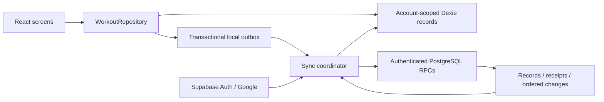

# Progression: Supabase implementation plan

Status: implementation is in progress on `feat/supabase-offline-sync`.
See `todo.md` for verified local work and remaining release gates.

User interface refinement: preserve the original theme and simple day-specific
exercise editor. The exact user-supplied four-day plan is predefined. Library
management stays optional; optional analytics are accessed from Activity. Latest user
feedback supersedes the timer tasks below: remove rest timer controls from workouts
and plan editing, and remove the workout's add-exercise form. Exercises are edited in
the day plan.

This is the execution plan for the existing React/Vite application. It refines
`progression-vert-implementation-plan.md` using the repository audit and the user's
confirmed choices: Supabase on the free plan and Google sign-in. Where the original
plan conflicts with the facts-only rule or existing unit semantics, this document
and AGENTS.md govern implementation. No infrastructure is provisioned by this plan.

## 1. Outcome and scope

A user logs workouts, runs, and body weight offline on a phone, restarts the app,
reconnects, and sees the same records on a laptop. Exercises have stable identities
across plans. Conflicting edits are visible and recoverable. Every legacy record is
accounted for, including incomplete or anomalous records.

Delivery order is data safety, authentication, sync, exercise/plan management,
logging improvements, analytics, then controlled release. Each stage must leave
the existing local app usable and pass its acceptance tests before proceeding.

Included:

- Google authentication through Supabase Auth, account separation and recovery states.
- Dexie local persistence, transactional outbox, idempotent server writes, ordered
  pull, deletion tombstones, explicit conflict resolution and sync status.
- Verified legacy migration, complete backup/export, and a documented rollback.
- Canonical custom exercises, duplicate review, archiving, explicit merges and plans.
- Mobile rest timer, undo, session exercise additions and faster factual logging.
- Responsive weekly/monthly/custom summaries using recorded facts.

Excluded:

- Estimated 1RM, goals, adherence targets, rolling averages, percentage/trend
  callouts, resistance estimates, advice and inferred muscle growth.
- Historical weight conversion, guessed missing values, fuzzy automatic merges.
- Paid infrastructure, a separate custom backend service, and a frontend rewrite.
- Collaboration between users, social features and public workout sharing beyond
  the existing user-triggered recap.

Local-only mode remains available. Cloud configuration is optional at build time;
missing configuration must not break existing local installs.

### Installable PWA delivery

The web app will remain an installable Progressive Web App on supported phone and
desktop browsers. This builds on the existing `vite-plugin-pwa` configuration,
standalone manifest, 192/512 PNG icons, Apple touch icon and generated service worker.
The existing build artifacts contain registration and app-shell precaching; actual
device installation and offline launch still require browser verification.

- Keep one React application for browser tabs and installed windows. Add Progression
  branding, a stable manifest identity, appropriate maskable icons and install help.
  Show a native install action only where supported; otherwise show browser-specific
  instructions, including iPhone's Add to Home Screen flow.
- Cache the application shell for offline launch after a successful online load.
  Save records and queued operations in the account-scoped IndexedDB repository.
  Never cache authenticated Supabase responses in a shared service-worker cache.
- Add an offline-ready indication and verify deep-link reloads. Serve production
  through HTTPS and configure hosting fallbacks for app routes and OAuth callbacks
  without rewriting manifest, JavaScript or service-worker asset requests to HTML.
- Replace unconditional service-worker activation with a tested update prompt.
  Allow postponement during logging, commit pending local saves before applying an
  update and preserve entered values. Test the transition from the existing
  `autoUpdate` deployment as well as subsequent prompt-based upgrades.
- Sync when the app is open or resumes and connectivity is available. Do not promise
  uploads while the app is closed; background execution differs between browsers.
  Show pending data until the server acknowledges it. First Google sign-in requires
  network access; existing cached account logging can continue offline.
- Verify Google OAuth return behavior in installed Android and iOS apps and desktop
  windows. Account identity must remain correct even when the OS opens the callback
  in a browser window with a different storage context.

Implement install/update/offline UI during M6 and make Android, iPhone and desktop
installation, offline cold launch, queued-write recovery and safe upgrades mandatory
M8 checks. No separate native app or app-store packaging is needed for this scope.

References: [PWA installation](https://developer.mozilla.org/en-US/docs/Web/Progressive_web_apps/Guides/Installing)
and [Vite PWA update behavior](https://vite-pwa-org.netlify.app/guide/auto-update).

## 2. Confirmed architecture and ownership

- UI data access stays behind `WorkoutRepository`; components never import Dexie
  or query Supabase tables. New interface methods update both implementations.
- Extend `DexieRepository` with configurable database identity, lifecycle and
  account-aware transactions. Keep Dexie imports confined to its existing file.
- Add an auth service, sync transport, sync coordinator, and reactive sync status
  as separate modules. The HTTP repository remains an interface-completeness stub;
  do not route production reads directly to a remote repository.
- Use one local database per Supabase project and account ID, plus the untouched
  original `workout-tracker` database for local-only history. Project ID prevents
  staging and production data from mixing when the auth user ID happens to match.
- On account transitions, stop sync, cancel or ignore old responses, unmount the
  old repository/UI tree, close subscriptions and database, then mount the new
  account. Do not render stale observable values across account boundaries.
- Offline cached account access is allowed for the last authenticated account on
  that browser until explicit sign-out. Expired network credentials pause uploads;
  local writes remain available. First sign-in and switching accounts require online auth.
- Signing out hides account data and retains pending operations in that account's
  database. No pending data is silently cleared or assigned to another account.

## 3. Physical data model

Remote IDs preserve existing strings; new entity and operation IDs use UUIDs.
Remote entity keys are `(user_id, id)`; all relationship checks include `user_id`.
Store timestamps as UTC instants and preserve original timestamp precision.

| Table | Record and integrity contract |
| --- | --- |
| `account_settings` | One account preference record; existing display/unit semantics retained. |
| `exercises` | Canonical name, normalized name, optional muscle/equipment metadata, archive state. Names are not unique IDs. |
| `templates` | Name, ordered JSON exercise assignments with stable assignment IDs, prescriptions, duration field and revision. Validate same-owner exercise references in RPCs. |
| `program_order` | One revisioned ordered template-ID list per account. Reordering changes this aggregate atomically instead of independently overwriting template positions. Local `order` fields remain an adapter detail. |
| `sessions` | Plan ID, historical plan name, ordered exercise/prescription snapshots, start/end/status/notes/feeling. Historical plan links may outlive archived plans. |
| `sets` | Session ID, canonical exercise ID, session-assignment ID for new records, exercise-name snapshot, value/metric/warm-up, timestamp and ordering. Repeated exercise assignments remain distinguishable. |
| `runs` | Original dates, distance, duration and optional fields. Missing legacy values remain nullable. |
| `body_weights` | Original date and weight; optional explicit entry unit on new data, without retroactively assuming units. |
| `sync_receipts` | Owner and operation ID, request fingerprint and immutable result, including accepted revision. Reusing an ID with another payload is rejected. |
| `account_sync_state` | Per-account serialization lock and monotonic journal sequence. |
| `sync_changes` | Owner, sequence, entity identity, revision and full accepted value or tombstone. Index by owner/sequence. |
| `exercise_merges` | Source IDs, canonical target, explicit user action and timestamp. No silent name-based merge. |
| `migration_imports` / `migration_records` | Source checksum, original raw records, mappings, validation issues and reconciliation status. Preserve unresolved records without disabling relational checks for ordinary writes. |

Every mutable entity has a server-controlled revision and update timestamp.
Deletions retain a tombstone; normal sync cannot physically remove history needed
by another client. Journal and receipt retention start without automatic pruning;
monitor free-plan usage and design a safe bootstrap/compaction protocol before pruning.

New local stores require an additive Dexie version bump after v3: outbox, sync
metadata, conflicts, migration state, and ordering metadata as needed. Preserve
existing stores; test upgrading a real v3-shaped database. Export all recoverable
account records, unresolved migration payloads and conflicts. Pending transport
metadata is local recovery data and must never be blindly replayed into another account.

## 4. Sync protocol and conflict decisions

### Local writes

Validate input, write the local record, and enqueue an operation in one transaction.
Stable operation IDs survive retries and restarts. An operation includes account,
entity type/ID, mutation, payload, base revision and local dependency information.
The caller receives success only after the local transaction commits.

Serialize dependent operations for one entity. Rebase subsequent unsent operations
only after a predecessor's accepted revision is known. Never mutate a transmitted
operation's payload; a new intent gets a new operation ID. Queue dependencies send
parents before children. Related actions such as deletion/renumbering, reordering,
session creation and exercise merges use explicit atomic operation groups.

### Push

Use a bounded `sync_push` RPC with validated operation groups. Derive ownership
from `auth.uid()`. Reject unauthenticated calls, unsupported protocol versions,
oversized batches, invalid payloads and cross-account relationships.

Within one server transaction, serialize by account, check receipt/fingerprint,
check base revision, apply the group, append ordered changes and record the result.
Return per-operation accepted/already-applied/conflict/rejected results. An atomic
group fails as a group. Retried accepted operations return their original result.
The next account mutation cannot allocate a journal sequence ahead of an earlier
uncommitted mutation. Client timestamps never determine the pull cursor.

### Pull and restart

Use a paginated `sync_pull(cursor, limit)` RPC ordered by account sequence. Initial
bootstrap uses the same journal from its start. Apply a page and advance its cursor
in one local transaction. A crash before commit replays the page safely.

Keep pending local edits separate from accepted server state so a pull cannot
overwrite an offline edit. Acknowledging an earlier edit must not overwrite a newer
pending edit. Persist all remote conflicting revisions for review.

Trigger sync after auth/bootstrap, online reconnect, successful local mutations,
tab focus and a modest foreground polling interval. Realtime can later trigger a
pull but is not needed for correctness. Use cross-tab leader coordination or
leases; correctness still relies on server idempotency and revisions.

Retry network/temporary server failures with capped exponential backoff and jitter;
persist scheduling state. Authentication failure pauses for reauthentication;
validation failures remain visible. An offline browser flag is only a hint.

### Conflicts and deletion

| Record | Behavior |
| --- | --- |
| Exercise metadata | Revision mismatch preserves both versions; user selects a version or edits a combined result. |
| Plan prescriptions and rotation | Resolve the whole ordered aggregate; do not silently combine incompatible reorders. |
| Active or completed workout/set | Retain both revisions; no silent overwrite or duplicate set creation. |
| Run/body weight | Same revision-aware explicit resolution. |
| Preferences | Revision-aware initially, with an explicit local/remote choice; avoid unnecessary last-write-wins rules. |
| Edit versus delete | Preserve edit as a conflict; never implicitly resurrect a tombstoned entity. Restoration requires a new explicit operation against the latest revision. |

Resolution creates a new operation against the latest server revision. Another
concurrent edit can conflict again. Independent entities continue syncing while
conflicting entities and their dependants wait. Status distinguishes saved locally,
pending, syncing, synced, offline, sign-in required, errors and conflicts. “Synced”
means no unresolved local operations/conflicts and a completed pull, with last-sync time.

## 5. Google sign-in and environment setup

Use `@supabase/supabase-js` with Google OAuth and PKCE. Add a callback route before
the current onboarding gate, exchange the code exactly once, handle denial/expired
code/missing verifier, then choose or create the account repository. Preserve the
intended internal route without accepting arbitrary redirect destinations.

User-owned setup, needed before hosted verification:

1. Create a Supabase project in a free organization and retain its database password
   privately. Select a suitable nearby region; do not enable a paid plan.
2. Create/configure a Google Cloud OAuth web client and consent screen. Add Google
   test users if the consent app is in testing. Request only identity/profile/email scopes.
3. Set Google's authorized redirect URI to the callback displayed by Supabase's
   Google provider settings. Enter the OAuth client ID and secret in Supabase, not the frontend.
4. Set Supabase's site URL and allowlisted app callback URLs for development and
   production. Configure localhost separately from production; avoid broad preview wildcards.
5. Configure `VITE_SUPABASE_URL` and `VITE_SUPABASE_PUBLISHABLE_KEY` in ignored
   `.env.local` and the deployment environment. Commit only `.env.example` placeholders.

No service-role key or Google client secret belongs in browser variables, source
control or chat. Local SQL tests use the Supabase CLI/local container stack. Hosted
Google sign-in needs a manual smoke test; unit tests must not depend on real credentials.

Sources checked: [Google setup](https://supabase.com/docs/guides/auth/social-login/auth-google),
[PKCE](https://supabase.com/docs/guides/auth/sessions/pkce-flow),
[migrations](https://supabase.com/docs/guides/local-development/database-migrations),
and [RLS](https://supabase.com/docs/guides/database/postgres/row-level-security).

## 6. Ordered implementation stages

Each numbered item below is a reviewable change, normally one small commit. Keep
feature flags off until each milestone's tests pass. Implementation work may reveal
a need to split a commit further; update this plan when that affects a contract.

### M1 — Local integrity and migration foundation

1. Review and validate the existing uncommitted migration-inspection and local
   snapshot changes without accidentally including unrelated work in commits.
2. Add missing repository tests: v3 upgrade, persistence after database close/open,
   consistent exports during mutation, imported numbering gaps and transaction rollback.
3. Build a pure migration adapter/report: exact IDs and field comparisons,
   SHA-256 source checksum, relationship inventory and explicit unresolved records.
4. Inspect the actual export when available; create an anonymized relationship-preserving
   fixture. Preserve original data privately; do not commit the personal source export.
5. Add versioned recovery export/import while retaining v1 import support. Separate
   local-only replacement from account restore; account restore must produce ordinary
   versioned sync operations, never clear records behind the sync engine.

Exit: all source records accounted for; re-import is idempotent; failed import rolls
back; full export works. Real-backup reconciliation remains a cutover gate if its
source is unavailable, not a reason to fabricate data or block unrelated development.

### M2 — Cloud schema and authorization

6. Add local Supabase configuration and additive SQL migrations for entities,
   revision metadata, ordering, migration records and account ownership.
7. Add read policies, restricted grants and narrowly scoped RPC execution privileges.
   Secure any privileged function with a fixed search path and explicit auth checks.
8. Implement transactional push, operation receipts and account serialization.
9. Implement paginated pull and initial bootstrap; test commit order, not just
   timestamp or sequence allocation order.
10. Add local SQL integration tests for anonymous access, account A/B separation,
    forged owners, invalid relationships, direct-write denial, atomic groups and retries.

Exit: migrations rebuild a fresh database; denied access is tested; protocol writes
are the only mutation path; no production reads/writes have switched.

### M3 — Account-scoped local storage and authentication

11. Add configurable Dexie database identity/close lifecycle and remount provider
    state on account changes. Keep local-only operation as the default fallback.
12. Add account-local schema stores for outbox, accepted revisions, cursor and conflicts.
13. Add the auth service, Google/GitHub buttons, PKCE callback and sign-out UI.
14. When a user signs in online, pull the account state, then merge local records into
    the account automatically through resumable versioned operations. Preserve the
    original local database and existing account records; skip differing ID collisions.
    Never copy a foreign outbox or overwrite account preferences during this merge.

Exit: account switches never expose cached prior-account UI; offline local records
remain available in the correct scope; online sign-in merges local history and syncs it.

### M4 — Offline synchronization

15. Route every account write, including seeds/imports/reorders/deletes, through one
    local mutation/outbox transaction. Seeding an account must not independently create
    duplicate default plans on multiple devices; bootstrap or server idempotency owns it.
16. Add the typed Supabase RPC transport and persistent push/acknowledgement handling.
17. Add pull application, durable cursors and pending-edit protection.
18. Add background scheduling, retry/backoff, cross-tab coordination and account-bound
    cancellation. A late response must not update another account's records or cursor.
19. Add tombstone handling and explicit conflict review/resolution with both versions.
20. Add visible sync status and retry controls in logging and Settings.
21. Add two-client tests for offline restart, timeout after server commit, partial
    batch rejection, dependent edits, delete-versus-edit and concurrent ordering.

Exit: a phone-created offline workout appears once on a second client; no local write
is lost to a request failure; deletions stay deleted; conflicts preserve both inputs.

### M5 — Canonical exercises and reusable plans

22. Add canonical exercise create/edit/archive repository methods, metadata and reactive
    library reads. Archive hides new assignments while retaining existing history.
23. Replace TemplateEditor's implicit name-based identity selection with explicit library
    selection and custom creation. Show duplicate-name matches and allow intentional
    distinct movements. Existing selected IDs survive unrelated prescription edits.
24. Add assignment IDs, per-plan sets/reps/time/rest and stable order. Never backfill
    unavailable legacy prescription snapshots from a changed plan.
25. Add explicit transactional merges with impact preview, revision checks and audit;
    update canonical references while preserving historical names and original import mappings.

Exit: one exercise works across multiple plans; changing one prescription does not
change another plan or completed workout; archive and merge preserve history.

### M6 — Phone logging

26. Add library/custom exercise insertion into a session snapshot without changing its
    source plan. Repeated assignments use their own identity throughout logging.
27. Add save-in-progress/error handling, prevent accidental double taps, preserve the
    existing previous-session prefill guard and keep warm-ups out of working-set totals.
28. Add an optional user-started rest timer with deadline-based restart recovery; no
    recommended rest duration or inferred advice. Add explicit undo of the last saved
    set using a compensating versioned mutation, even if it already synced.
29. Verify run/body-weight editing offline with accurate saved/pending/error feedback.
    Align recap formatting with time metrics and zero external weight.

Exit: accessible phone logging, timer/undo recovery, previous values and all existing
metric/warm-up behaviors pass integration tests.

### M7 — Factual dashboard and responsive layouts

30. Build shared pure date-range and aggregation functions. Use local calendar dates,
    Monday-start weeks, inclusive start/exclusive end bounds and DST tests.
31. Add weekly/monthly/custom completed-session and working-set totals, recorded
    running distance/duration/pace, and dated body-weight entries.
32. Add exercise/plan/muscle filters and primary-muscle working-set counts. Keep unknown
    muscle data visible; do not guess attribution or introduce secondary-muscle weighting.
33. Reuse the existing exercise progression chart. Add responsive desktop summaries
    and mobile navigation while retaining existing routes and deep links where possible.

Volume means external load times repetitions only for eligible weighted rep sets
within the same exercise, unit and load convention; exclude warm-ups and timed sets.
Do not aggregate ambiguous legacy units into a kilogram total. Running pace uses
valid recorded distance and duration, never targets. No previous-period percentage
callouts, rolling averages or estimated metrics.

Exit: independently checked fixtures match every summary; incomplete sessions,
missing data and invalid runs remain accessible without distorting calculations.

### M8 — Hosted verification and controlled release

34. Reproduce migrations on the new free project, configure Google sign-in and perform
    an authenticated phone/laptop smoke test with test data.
35. Reconcile a fresh real export against destination IDs, values, timestamps,
    relationships, unresolved records and checksums. Repeat import and resume an
    interrupted migration without duplication.
36. Verify installed PWA upgrades, offline reload, account switching, Google callback,
    long-disconnected clients, small/large screens and sync failures on real devices.
37. Publish release/recovery instructions, export a fresh backup and enable sync in
    a controlled rollout only after gates pass. Retain the original local store and
    prior deployment; do not delete legacy data automatically.

Exit: all definition-of-done scenarios pass; failures and unresolved migration records
are disclosed; the user can export, recover and return to a known local build.

## 7. Verification and release gates

| Layer | Required evidence |
| --- | --- |
| Pure logic | Validation, normalization, revision/dependency handling, migration reconciliation, factual analytics and calendar boundaries. |
| IndexedDB | Upgrade, restart, atomic outbox writes, rollback, cursor application, queued edit protection, recovery import/export. |
| PostgreSQL | Fresh migrations, RLS/grants, same-owner links, replay fingerprints, revisions, serialization and group atomicity. |
| React integration | Account remount, callback errors, offline states, conflict choices, exercise selection, logging and undo. |
| Two-client browser tests | Offline write/restart/reconnect, timeout after commit, concurrent edit/delete/reorder, sign-out with pending operations and account switch during request. |
| Hosted manual checks | Real Google sign-in, installed PWA, phone/laptop propagation and free-project unavailable/recovery behavior. |

Use existing Dashboard repository injection tests as the page pattern and
fake-indexeddb for local persistence. Add a browser test runner for genuine restart,
service-worker and multi-client scenarios; in-memory transport tests alone do not
establish offline reliability. SQL tests run against isolated local Supabase, not
production. CI runs lint, `tsc -b`, unit/integration tests and build, with separate
database/browser jobs. Keep credentials and real exports out of logs/artifacts.

Run focused checks per change; run the full suite at milestone completion. Review
each milestone against both AGENTS.md and this plan. Existing lint/bundle warnings
are baseline observations, not evidence of new correctness failures.

## 8. Recovery, risks and decisions that remain

- Free-tier limits and idle pausing can interrupt network sync. Preserve pending work,
  show availability errors and document resuming the project. Never auto-upgrade.
- Browser storage can be evicted. Provide backup tools and synced-state visibility;
  optional persistent-storage permission does not guarantee retention.
- Shared-device isolation is a UI/account boundary, not encryption against someone
  controlling the browser profile. Do not claim otherwise.
- Legacy anomalies remain raw migration records with explicit repair paths. Cutover
  requires record accounting; it must not quietly discard failed validations.
- Conflict history and journals consume space. Measure usage before considering
  compaction; never prune changes needed by an offline client without a safe rebootstrap.
- Before cutover, rollback means using the retained local database/deployment. After
  cloud writes begin, export current account state and reconcile pending operations
  before restoring into a local build; reverting code alone does not recover new data.
- Remaining external inputs: actual backup, project URL/public key, configured Google
  OAuth and production app URL. They do not prevent M1 or local SQL development.

No further product interview is required to start M1. A new question is warranted
only if implementation reveals a decision that changes historical meaning, deletes
data, incurs cost or expands scope beyond the rules above.
